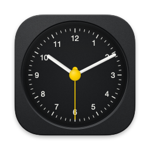
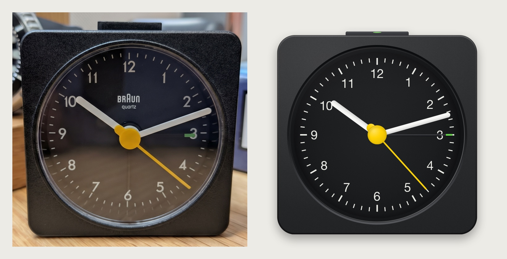
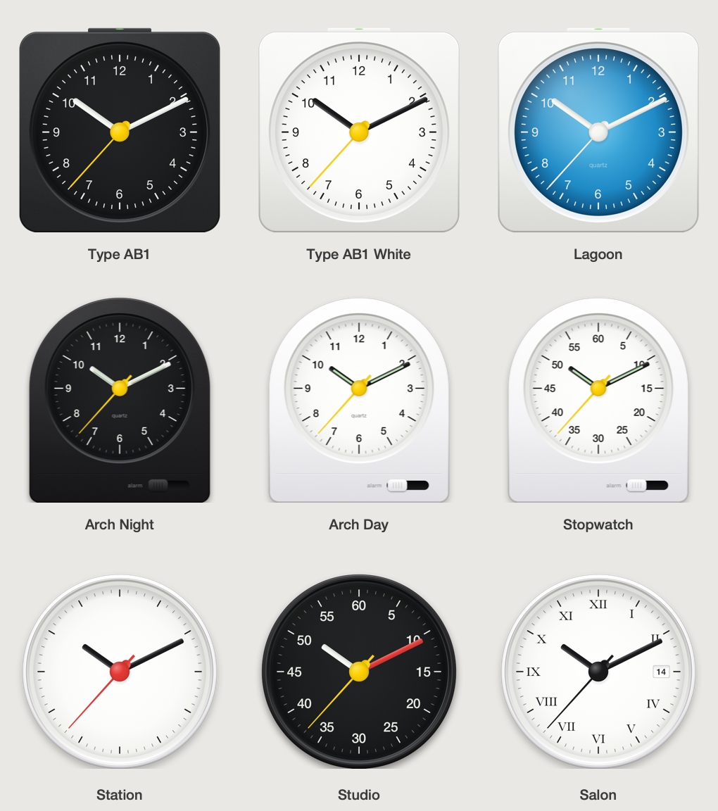
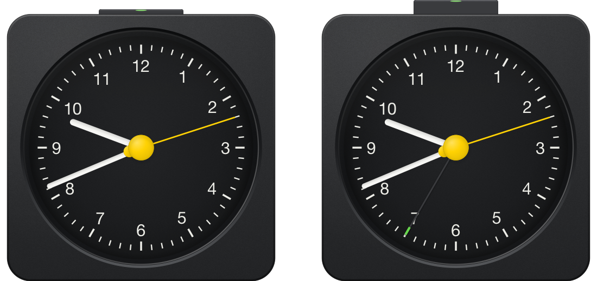
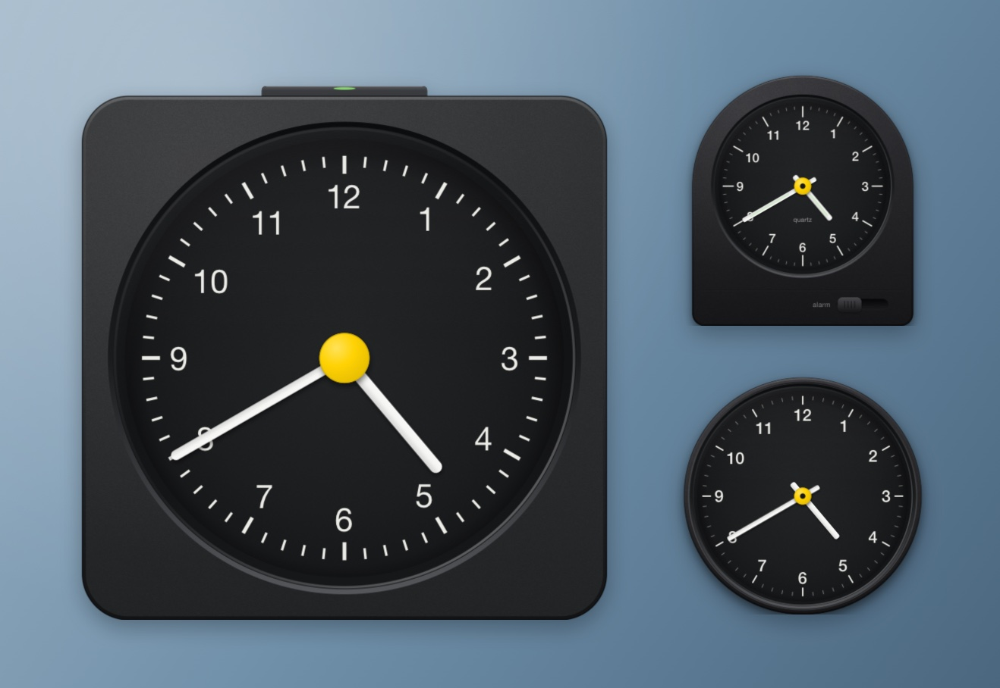
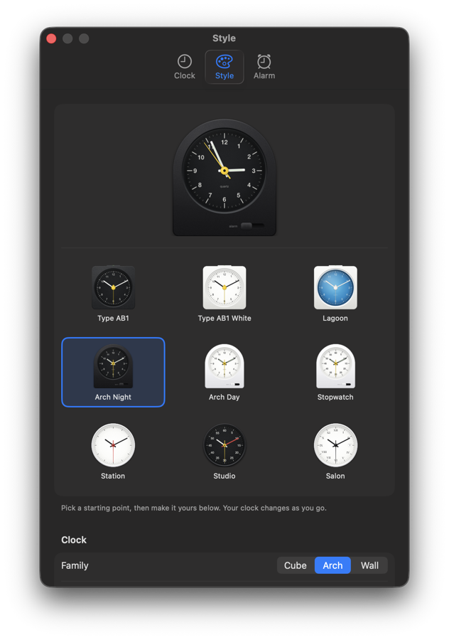
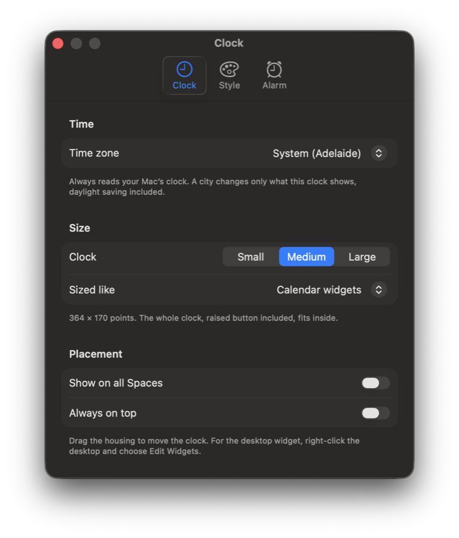
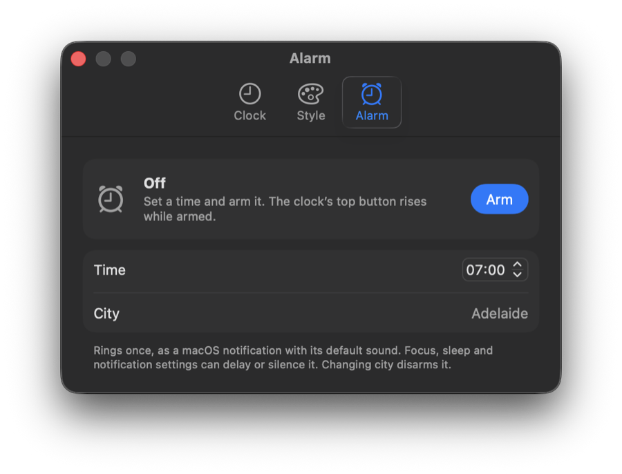
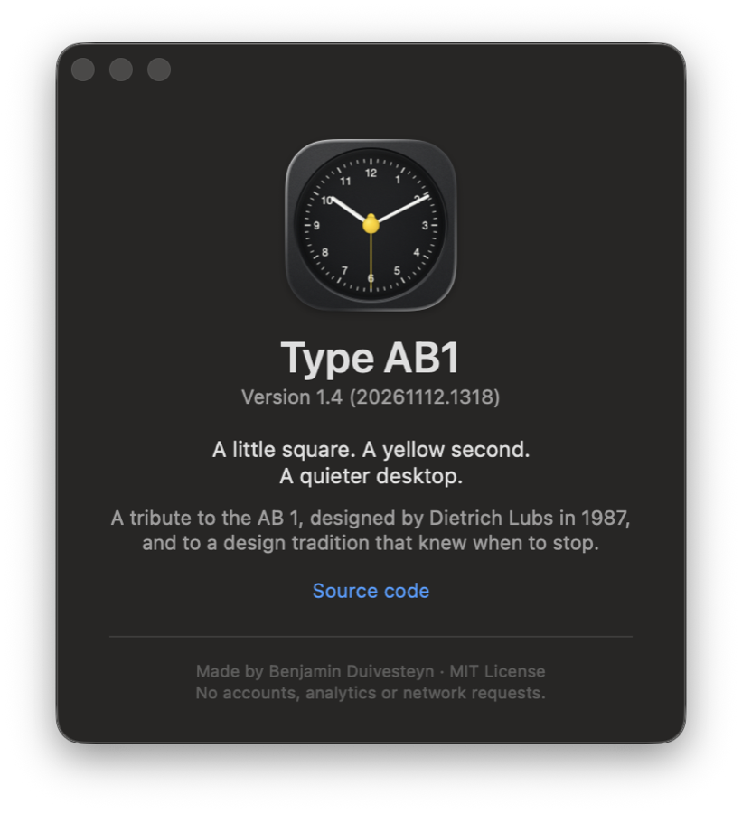

<div align="center">



# Type AB1

**A little square. A yellow second. A quieter desktop.**

An analog clock for your very digital Mac.<br>
Three hands, a green button, and excellent manners.


<br>



*Left, the real one on my desk. Right, Type AB1, drawn entirely in code and set to the same moment.*

</div>

---

Put it in a nice corner. Let the yellow hand take its little walks. Occasionally discover that it is, somehow, already lunchtime.

No batteries required. One Mac recommended.

```sh
git clone https://github.com/duivesteyn/type-AB1A.git && cd type-AB1A && ./Scripts/install.sh
```

## Contents

- [A small ode to a small square](#a-small-ode-to-a-small-square)
- [Meet your new desk companion](#meet-your-new-desk-companion)
- [A clock for every desk](#a-clock-for-every-desk)
- [A button with a job](#a-button-with-a-job)
- [A cousin in the widget gallery](#a-cousin-in-the-widget-gallery)
- [Get ticking](#get-ticking)
- [Getting along with it](#getting-along-with-it)
- [Settings and About](#settings-and-about)
- [When something seems off](#when-something-seems-off)
- [A clock that lives in a tab, too](#a-clock-that-lives-in-a-tab-too)
- [Light on its feet](#light-on-its-feet)
- [For fellow tinkerers](#for-fellow-tinkerers)
- [Made with a fondness for useful things](#made-with-a-fondness-for-useful-things)
- [What changed](CHANGELOG.md)

## A small ode to a small square

> O little square of sensible things,\
> with yellow feet and minute wings,\
> no feed to scroll, no world to save —\
> just time, behaving. Mostly. Brave.

Type AB1 is a digital tribute to the **AB 1**, designed by **Dietrich Lubs in 1987**, and to the clarity of the design tradition around **Dieter Rams**. A small thank-you to an object that knew when to stop designing.

The real desk companion behind the digital one is my own AB1A, [photographed here on 14 October 2026](20261014_Braun_AB1A_Type3885_BMD.jpeg). Its yellow hand was doing its rounds long before this app had a bundle identifier. Type AB1 is my way of giving it a small, pixel-powered cousin.

## Meet your new desk companion

- **Purely analog.** White hour and minute hands, a yellow ticking second hand with its round counterweight, and a tactile little top button. The time stays on the dial.
- **Drawn, not pasted.** Housing, dial, numerals, hands and crystal are all drawn in code from one set of measurements, taken from the real clock. Matte grained plastic, a recessed dial under clear glass, shadows that fall the way the light does. Sharp at 16 pixels and at full screen, and shared by the app, the widget, the icon and the browser preview.
- **Your Mac keeps the time.** It reads the real system time on every tick. System time zone is the default; choose a city to look elsewhere in the world, and macOS handles daylight saving and those delightfully awkward half-hour offsets.
- **A size that gets along with its neighbours.** The default **Match Calendar** reference uses **170 × 170**, **364 × 170** and **364 × 382** points. Choose **Native Mac** for **164 × 164**, **344 × 164** and **344 × 344**. The whole clock, raised button included, stays inside its footprint; wide layouts centre it. The artwork keeps its industrial corners and original proportions, never stretched into another shape.
- **Dock only.** Lives in your Dock, with a full menu there and on the clock itself. Nothing is added to your menu bar.
- **Sits where you put it.** Every clock stands on the bottom edge of its window, so it can rest right on the bottom of your screen.

## A clock for every desk

<div align="center">

<picture>
  <source media="(prefers-color-scheme: dark)" srcset="docs/images/styles-dark.png">
  
</picture>

</div>

Three families of clock, each drawn in full detail, and nine presets to start from. Right-click the clock and choose **Style**, or open **Settings → Style** to make one your own.

| Family | What it is | Made in |
| --- | --- | --- |
| **Cube** | The square desk alarm clock that started it all, with its top button | Black, White, Lagoon (a glossy teal-blue dial) |
| **Arch** | A round-topped desk alarm clock, like a tiny tower, with an alarm slider in its base | Black, White |
| **Wall** | A round wall clock with a broad moulded rim and a large, airy dial | White, Black |

Every finish can also **Match appearance**: black in Dark Mode, white in Light.

Then make it yours:

- **Numerals:** 1 – 12, 5 – 60 (minutes, like a stopwatch), Roman, just 12 · 3 · 6 · 9, or none.
- **Hands:** Classic yellow seconds, Luminous (a mint strip in each hand), Red minute, Red seconds (station-clock style), All red, or Monochrome.
- **Seconds:** **Tick**, a smooth **Sweep**, or **Off**, remembered separately for each family: your wall clock can sweep while your cube ticks. Change it from the right-click menu under **Seconds**, too.
- **Details:** a date window in place of the 3, “quartz” printed on the dial, and the crystal’s reflection.

## A button with a job

<div align="center">



*Down: no alarm. Up: armed, with the alarm hand pointing at the time.*

</div>

Click the top button and the **Alarm** settings open: pick a time, choose **Arm**, and the button rises. **Up means armed, down means off**, and a slim green-tipped hand points at the alarm time while it is set. Click the raised button to disarm. You can also arm and disarm from the right-click or Dock menu. With Reduce Motion on, the button simply snaps into place.

On the **Arch**, the alarm is the slider in the base: slide it across to uncover signal green. The **Wall** clock has no control of its own, so use the menu or Settings; its green-tipped alarm hand still shows when armed.

> [!IMPORTANT]
> Alarms use macOS notifications and the default notification sound. Allow notifications for Type AB1 before arming one. Focus, sleep and notification settings can delay or silence delivery, so treat it as a friendly reminder rather than your sole defence against missing a flight. Changing time zone disarms the alarm so you can set it again for the new city.

## A cousin in the widget gallery

<div align="center">



</div>

Three native widgets bring the clocks to the desktop and Notification Centre: **Type AB1** (the cube), **Type AB1 Arch** and **Type AB1 Wall**, each in **Small** and **Large**. They follow your Mac’s appearance: black in Dark Mode, white in Light. Open **Edit Widgets** and look for **Type AB1**.

It shows hours and minutes. The seconds hand takes a well-earned holiday: WidgetKit shows prepared snapshots, and **macOS decides when to display updates**. Type AB1 prepares three hours of minute positions at a time and asks for fresh ones after the first hour, so a late refresh never stops the hands.

While the app is running, it also keeps the widgets honest. macOS sometimes stops refreshing a widget after a long sleep, so Type AB1 restarts its own widget process and asks for fresh timelines at launch, on every wake, and every third hour, with a plain refresh in between. Keep the app running (it lives in the Dock anyway) and the widgets stay on time. [Apple explains the refresh rules here](https://developer.apple.com/documentation/widgetkit/keeping-a-widget-up-to-date).

The command-line build’s widget follows your **system time zone**. The Xcode build adds a city choice per widget.

## Get ticking

**Requires macOS 14 or later.** The command-line build targets **Apple silicon**.

**Build and install** (replaces `/Applications/Type AB1.app` and launches it):

```sh
./Scripts/install.sh
```

**Just build**, to try it from the `build` folder:

```sh
./Scripts/build.sh
open "build/Type AB1.app"
```

Keep one copy around: running both the `build` copy and an installed one gives macOS two widgets with the same identity. `install.sh` takes care of that for you.

If you have a downloaded build, unzip it and move **Type AB1.app** to Applications. The widget lives inside the app; there is nothing else to install.

**Prefer Xcode?** Open `Clock.xcodeproj`, select the **Clock** scheme, choose your Apple development team for both targets, and run. The built app is Type AB1. Added a source file? Regenerate the project with `python3 Scripts/generate-project.py`.

> [!TIP]
> The command-line build is ad-hoc signed for local use. Distribution signing and notarization are separate steps.

## Getting along with it

| To | Do this |
| --- | --- |
| Move the clock | Drag the housing |
| Set or clear the alarm | Click the top button (or press Space or Return when the clock is selected) |
| Change style, seconds, city, size, Spaces or **Always on Top** | Right-click the clock, or use the Dock menu |
| Open Settings | **⌘,** |
| Bring the clock back | Click the Dock icon, or **Window → Show Type AB1** (**⌘0**) |
| Add the widget | Right-click the desktop → **Edit Widgets** → **Type AB1** |

Settings, size and position are remembered between launches. With **Show on all Spaces** off, the clock stays on the Space you put it on.

> [!NOTE]
> Choosing a city changes only what this clock shows. It never changes your Mac’s time or Apple Clock’s World Clock list.

## Settings and About

<div align="center">

 

 

</div>

**Settings** (**⌘,**) has three tabs, in the style of System Settings:

- **Clock**: the time zone (your Mac’s, or a city), the clock’s size and which widgets it matches, and placement: all Spaces, and always on top.
- **Style**: a live preview, the preset gallery, and every option for the family you choose.
- **Alarm**: whether an alarm is armed and when it rings, an **Arm**/**Disarm** button, and the alarm time. The clock’s top button opens this tab.

**About** shows the version, credits and links to the original clock and this source.

## When something seems off

<details>
<summary><strong>The widget is stuck on an old time</strong></summary>

Open Type AB1 (or quit and reopen it). At launch it restarts its widget process and asks macOS for fresh timelines, which fixes a stuck widget within a few seconds. It does the same on every wake and every third hour while running, so this should only happen if the app was quit.

Still stuck? macOS may know about more than one copy of the app. Run `./Scripts/install.sh`: it installs the only registered copy into `/Applications`, stops any old widget process and launches the app. If an old widget still won’t budge, remove it from the desktop and add it again.

</details>

<details>
<summary><strong>The alarm didn’t sound</strong></summary>

Check **System Settings → Notifications → Type AB1** is allowed, with sound on, and that Focus isn’t holding it back. If macOS refused permission, the Alarm tab says so. A sleeping Mac can deliver it late. The button drops back down once the alarm time has passed, delivered or not.

</details>

<details>
<summary><strong>The clock disappeared</strong></summary>

It may be on another Space, or behind a window. Click the Dock icon or press **⌘0**. Right-click the clock and choose **Always on Top**, or turn on **Show on all Spaces** in Settings, if you’d like it to stay in view.

</details>

## A clock that lives in a tab, too

Open `art/Clock-Live-Preview.html` in a browser. It uses the app’s own artwork, works offline, and follows light and dark mode. Pick a city, watch the hands, and give the button a little click.

The browser button demonstrates the mechanism; it does **not** schedule an alarm. A small museum exhibit, with unusually accurate opening hours.

## Light on its feet

The desktop clock is built from **Core Animation** layers. The case and dial are drawn once for the size on screen; each hand is a small image that macOS turns. A ticking clock updates its hands once a second. A sweeping seconds hand is one continuous turn that macOS runs by itself, so even Sweep costs the app next to nothing. Everything pauses while the clock is covered or on another Space.

On 12 November 2026, at a 170-point clock height, the idle clock measured **about 18 MB of memory**, with **0.0% CPU** whether ticking or sweeping. The **20 MB goal applies to the idle desktop clock**; larger sizes, Settings and About can use more. The widget runs in a separate macOS process.

**No accounts, analytics or network requests.** Nothing leaves your Mac.

## For fellow tinkerers

| Where | What lives there |
| --- | --- |
| `Sources/Shared/ClockStyle.swift` | Families, finishes, numerals, hands, seconds and the presets |
| `Sources/Shared/ClockDesign.swift` | **The cube**: every measurement, colour and drawing step of the original |
| `Sources/Shared/ClockFamilies.swift` | **The arch and the wall**, each in its own artboard units |
| `Sources/Shared/ClockFaces.swift` | Palettes, and the dial kit every face shares: ticks, numerals, hands, hub, date window, glass |
| `Sources/Shared/ClockRaster.swift` | Renders and caches the still parts per style and size |
| `Sources/Shared/` (others) | Clock maths, sizes, and the SwiftUI layers for widget and About |
| `Sources/App/` | Desktop view, Settings and About windows, menus and alarms |
| `Sources/Widget/` | Widget configuration and timeline |
| `Scripts/` | Build, install, icon, image, preview and Xcode-project tools |
| `docs/images/` | README pictures, rendered from the app’s artwork |
| `art/Clock-Live-Preview.html` | Browser preview, regenerated from the app’s artwork |
| `art/Clock-Live-Artwork-v1/` | The original raster artwork package, kept for reference |
| `Config/` | Bundle details and entitlements |

The cube’s artwork shares a **1254 × 1254** artboard, and its hands turn around **(627, 677)**. Please keep that pivot: a clock with wandering elbows is a different project entirely. Renderers show the square from **(76, 98)**, **1102** units on a side, which holds the housing and the fully raised button. The arch and the wall each have their own units; every face’s visible area ends exactly at its base.

**Adding a preset** is one line in `ClockPreset.all`. A new family is a type that follows the `ClockFace` protocol: its crop, its dial, and how to draw its case and alarm control.

**Links** open the app where you need it: `typeab1://settings`, `typeab1://style`, `typeab1://alarm`, `typeab1://about`, and `typeab1://show` (the widget uses this one). `typeab1://style?preset=station` switches straight to a preset, handy for Shortcuts.

**The icon** is the clock’s own housing, filling Apple’s rounded-square icon shape (824 points on a 1024 canvas). macOS 26 shows icons that fill that shape at full size; anything else is shrunk onto a grey tile. Below 64 pixels it drops the numerals and minute ticks and thickens the hands. It is set to **10:10**: it likes to look cheerful for photographs.

Changed the artwork? Refresh everything drawn from it:

```sh
./Scripts/make-icon.sh              # Resources/icon-*.png and Clock.icns
./Scripts/make-readme-images.sh     # docs/images (the window screenshots are taken by hand)
./Scripts/render-previews.sh        # build/Previews, for a quick look
python3 Scripts/make-preview-html.py && node Scripts/check-html.js
```

<details>
<summary><strong>Run the checks</strong></summary>

```sh
swiftc -parse-as-library -module-cache-path build/module-cache \
  Sources/Shared/ClockTime.swift Tests/ClockTimeTests.swift -o build/ClockTimeTests
build/ClockTimeTests

swiftc -parse-as-library -module-cache-path build/module-cache \
  Sources/Shared/ClockTime.swift Sources/Shared/ClockLayout.swift Sources/Shared/ClockDesign.swift \
  Sources/Shared/ClockRaster.swift Sources/Shared/ClockStyle.swift Sources/Shared/ClockFaces.swift \
  Sources/Shared/ClockFamilies.swift Tests/ClockLayoutTests.swift -o build/ClockLayoutTests
build/ClockLayoutTests
```

The first covers midnight rollover, Adelaide’s half-hour offset, daylight-saving transitions, next-alarm scheduling and the widget’s three-hour timeline. The second covers the size references; for every family, that the case and alarm control fit the visible area, the hands stay inside the ticks and the case reaches the bottom edge; that styles save and load (including older or unknown values); and that all nine presets render in Light and Dark. Live widget updates, alarm delivery across sleep and restarts, and Spaces behaviour still need testing on a Mac.

</details>

## Made with a fondness for useful things

By **Benjamin Duivesteyn**. Source and included project artwork are released under the **[MIT license](LICENSE)**, with the original design credited to Dietrich Lubs. See [what changed](CHANGELOG.md) in each version.

| | |
| --- | --- |
| **App** | Type AB1 2.0 · `com.duivesteyn.typeab1` |
| **Executable** | `TypeAB1` |
| **Widget** | `TypeAB1Widget.appex` · `com.duivesteyn.typeab1.widget` |

<div align="center">

*Wind nothing. Enjoy the tick.*

</div>
