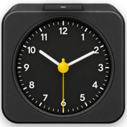
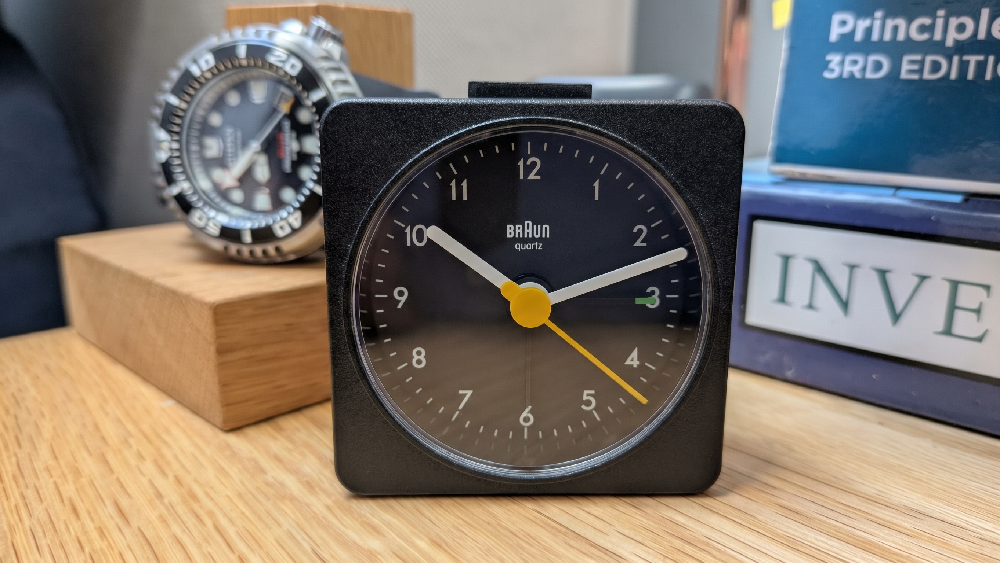

<div align="center">



# Type AB1

**A little square. A yellow second. A quieter desktop.**

An analog clock for your very digital Mac.<br>
Three hands, a green button, and excellent manners.


</div>

---

Put it in a nice corner. Let the yellow hand take its little walks. Occasionally discover that it is, somehow, already lunchtime.

No batteries required. One Mac recommended.

## Contents

- [A small ode to a small square](#a-small-ode-to-a-small-square)
- [The little square that started it](#the-little-square-that-started-it)
- [Meet your new desk companion](#meet-your-new-desk-companion)
- [A cousin in the widget gallery](#a-cousin-in-the-widget-gallery)
- [Get ticking](#get-ticking)
- [A clock that lives in a tab, too](#a-clock-that-lives-in-a-tab-too)
- [Light on its feet](#light-on-its-feet)
- [For fellow tinkerers](#for-fellow-tinkerers)
- [Made with a fondness for useful things](#made-with-a-fondness-for-useful-things)

## A small ode to a small square

> O little square of sensible things,\
> with yellow feet and minute wings,\
> no feed to scroll, no world to save —\
> just time, behaving. Mostly. Brave.

Type AB1 is an independent digital tribute to the **Braun AB 1**, designed by **Dietrich Lubs in 1987**, and to the clarity of Braun’s design tradition under **Dieter Rams**. A small thank-you to an object that knew when to stop designing.

The [Bröhan Museum’s Braun 100 exhibition catalogue](https://www.broehan-museum.de/wp-content/uploads/Bildliste_Braun100.pdf) credits the original. Our artwork is a reimagining of that clock family. Braun’s name and original design belong to their owners; this project has no affiliation or endorsement.

## The little square that started it

<div align="center">



*My own Braun AB1A — photographed by Benjamin Duivesteyn, 14 October 2026.*

</div>

This is the real desk companion behind the digital one. The yellow hand has been doing its rounds long before this app had a bundle identifier. Type AB1 is my way of giving it a small, pixel-powered cousin.

## Meet your new desk companion

- **Purely analog.** White hour and minute hands, a yellow ticking second hand, and a tactile little top button. The time stays on the dial.
- **Your Mac keeps the time.** System time zone is the default. Choose a city in settings to look elsewhere in the world; macOS handles daylight saving and those delightfully awkward half-hour offsets.
- **A size that gets along with its neighbours.** The default **Match Calendar** reference uses **170 × 170**, **364 × 170** and **364 × 382** points. Choose **Native Mac** for **164 × 164**, **344 × 164** and **344 × 344**. The whole visible clock, raised button included, stays inside its footprint. Wide layouts centre the analog clock; Retina pixels do their own thing underneath.

  The artwork keeps its industrial corners and original proportions. Type AB1 does not add an Apple-style enclosure or stretch the clock into a different shape. The real system widget fits the bounds supplied by WidgetKit automatically.
- **Drag it somewhere pleasant.** Grab the housing to move it. Right-click for settings, city, size and placement controls.
- **A button with a job.** Click the top control to set a one-time alarm. Up means armed; down means off. Click again to disarm. Reduce Motion keeps the button’s travels brief: it simply snaps into place.
- **A little presence in the menu bar.** Settings, About, and a graceful exit are one click away.

> [!NOTE]
> The clock reads actual system time on every tick. It follows your Mac’s Date & Time settings; choosing a city changes the display, not your Mac or Apple Clock’s World Clock list.

> [!IMPORTANT]
> Alarms use macOS notifications and the default notification sound. Grant notification permission before arming one. Focus, sleep and notification settings can delay or silence delivery, so treat it as a friendly reminder rather than your sole defence against missing a flight. Changing time zone disarms the alarm so you can set it for the new city.

## A cousin in the widget gallery

The native **Type AB1 widget** brings the same little square to macOS’s desktop and Notification Centre as a single small widget.

It is purely analog, with hour and minute hands. The seconds hand takes a well-earned holiday: WidgetKit supplies snapshots, and **macOS decides when to display updates**. An hour of minute positions is prepared ahead of time, without a continuously running timer. [Apple explains the refresh rules here](https://developer.apple.com/documentation/widgetkit/keeping-a-widget-up-to-date).

The command-line build’s widget follows your **system time zone**. The Xcode build also enables per-widget city selection through App Intents. Once the app is installed and discovered by macOS, open **Edit Widgets** and look for **Type AB1**.

## Get ticking

**Requires macOS 14 or later.** The command-line build targets **Apple silicon**.

If you have a downloaded build, unzip it and open **Type AB1.app**. The app contains its native widget extension; the widget is not a separate app to double-click.

**Build from source:**

```sh
./Scripts/build.sh
open "build/Type AB1.app"
```

**Prefer Xcode?** Open `Clock.xcodeproj`, select the **Clock** scheme, choose your Apple development team for both targets, and run. The scheme’s internal name is Clock; the built app is Type AB1.

> [!TIP]
> The command-line build is ad-hoc signed for local use. Distribution signing and notarization are separate steps. Configurable widgets use Xcode’s App Intents metadata processing.

**Added a source file?** Regenerate the project:

```sh
python3 Scripts/generate-project.py
```

## A clock that lives in a tab, too

Open `art/Clock-Live-Preview.html` in a browser. Its artwork is embedded, so it works offline. Pick a city, watch the hands, and give the button a little click.

The browser button demonstrates the mechanism; it does **not** schedule an alarm. The About panel contains the same ode and icon. A small museum exhibit, with unusually accurate opening hours.

## Light on its feet

The desktop clock uses **AppKit**, vector hands, one tick per second, and artwork decoded at its displayed size. No accounts, analytics, network requests or third-party runtime dependencies.

At a 164-point clock height, a fresh idle run on macOS 26.5.2 measured **17.2 MB physical memory footprint**. The **20 MB goal applies to the idle desktop clock**; larger sizes, Settings and About can use more. The system widget runs in a separate macOS host.

> [!TIP]
> Curious? About → **Measure idle use** shows a ten-second CPU sample and the current memory footprint. Opening About counts as activity — even a little clock notices when you admire it.

## For fellow tinkerers

| Where | What lives there |
| --- | --- |
| `Sources/App/` | Native desktop view, settings, alarms and the small ode |
| `Sources/Widget/` | Widget configuration and timeline provider |
| `Sources/Shared/` | Clock maths, size-aware artwork cache and layout |
| `Resources/Artwork/` | Production artwork layers |
| `art/Clock-Live-Artwork-v1/` | Original artwork package and vector references |
| `Config/` and `Scripts/` | Bundle details and build tools |

All artwork shares a **1254 × 1254** artboard. The hands turn around **(627, 677)**. Please keep that pivot: a clock with wandering elbows is a different project entirely.

The icon is set to **10:10**. It likes to look cheerful for photographs.

<details>
<summary><strong>Run the clock-maths checks</strong></summary>

```sh
swiftc -parse-as-library -module-cache-path build/module-cache \
  Sources/Shared/ClockTime.swift Tests/ClockTimeTests.swift -o build/ClockTimeTests
build/ClockTimeTests
```

These cover midnight rollover, Adelaide’s half-hour offset, daylight-saving transitions, next-alarm scheduling and widget timeline entries. Live widget updates, alarm delivery across sleep/reboot, and Spaces behaviour still need device testing.

</details>

## Made with a fondness for useful things

By **Benjamin Duivesteyn**. Source and included project artwork are released under the **[MIT license](LICENSE)**, with the original design credited to its owners.

| | |
| --- | --- |
| **App** | Type AB1 · `com.duivesteyn.typeab1` |
| **Executable** | `TypeAB1` |
| **Widget** | `TypeAB1Widget.appex` · `com.duivesteyn.typeab1.widget` |

<div align="center">

*Wind nothing. Enjoy the tick.*

</div>
